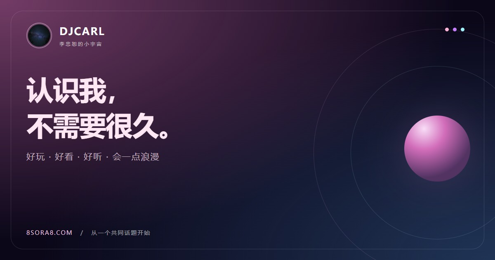

<h1 align="center">DJCARL · 小宇宙</h1>

好玩 · 好看 · 好听 · 会一点浪漫

原生前端个人主页，把自我介绍做成一次有配色、有节拍的见面。

<a href="https://8sora8.com/">在线体验</a> · <a href="#development">本地开发</a> · <a href="#deployment">自动部署</a> · <a href="https://github.com/CARL-JOSEPH-LEE/Website/releases">版本记录</a> · <a href="LICENSE">代码许可</a>

<h2>一页介绍，也是一间私藏电台</h2>

<ul>
  <li>三套心情主题：粉甜 Pink、紫夜 Purple、蓝绿 Cyan，一键切换并记住选择。</li>
  <li>真实音乐频谱：Web Audio 实时分析，Canvas 呈现 28 个对数频段、峰值拖影、霓虹曲线、节拍弧线与粒子。</li>
  <li>完整播放器：11 首歌单显示音频原始标签中的真实曲名，支持进度定位、音量与静音、自动下一首；支持的设备可通过 Media Session 查看歌名、艺人并控制播放。</li>
  <li>持续氛围：飘落爱心、旋转光环和鼠标轻微倾斜，滚动时继续呈现；暂停音乐时频谱定格。</li>
  <li>竞赛荣誉：展示第一届 CACC 总决赛安全赛道第十名、银奖，支持扫码或直接查看官方获奖证书。</li>
  <li>轻松互动：约会灵感、聊天开场白、问题与挑战，连续抽取避开上次结果，一键复制。</li>
</ul>

<h2>实现与隐私</h2>

HTML、CSS、JavaScript 原生实现，无框架、无后端、无第三方浏览器运行依赖。页面脚本、样式、图片和音频均从本站加载，不依赖外部字体或脚本 CDN。

首次播放前不请求 MP3，也不创建音频分析器。构建原样复制音频，不转码、不降低音质；频谱在浏览器本地分析，单个音频图与受控动画循环复用，暂停或进入后台停止频谱刷新。Canvas 独立合成、几何与纹理缓存减少重复绘制。

项目代码不接入分析埋点或上传接口。主题、上次曲目、音量、静音和动效偏好保存在本机 localStorage；禁用存储仍可使用。音量与动效开关在歌单面板中，关闭装饰动效会保留音乐频谱。

<h2 id="development">本地开发</h2>

要求 Node.js 20.19 或更新版本，推荐使用与 Netlify 一致的 Node.js 24。在项目目录启动开发预览，无需先安装依赖：

<pre><code>npm run dev</code></pre>

访问 <a href="http://127.0.0.1:4173/">http://127.0.0.1:4173/</a>。实时频谱请通过 HTTP 或 HTTPS 使用；直接打开 index.html 时，播放器使用原生音频路径。

安装构建依赖，生成并预览发布目录：

<pre><code>npm ci --omit=dev
npm run build
npm run preview</code></pre>

<a href="https://esbuild.github.io/">esbuild</a> 只在构建时参与脚本压缩、语法转换与样式压缩，不进入网页运行时。dist 为生成目录，不要手工修改。

需要验证改动时

基础检查覆盖构建、资源引用、缓存规则、压缩和音频分段请求；浏览器检查覆盖主题、播放器状态、滚动时持续动效、手机尺寸和兼容回退：

<pre><code>npm ci
npm test
npx playwright install chromium
npm run test:browser</code></pre>

也可用 BROWSER_EXECUTABLE_PATH 指向已有 Chrome 或 Edge。npm run check 会连续运行基础与浏览器检查，结果存入已忽略的 test-results 目录。

<h2 id="deployment">GitHub → Netlify → 8sora8.com</h2>

当前 Netlify 项目已连接本仓库 main 分支，推送提交后自动构建并发布到 <a href="https://8sora8.com/">8sora8.com</a>。仓库中的 <a href="netlify.toml">netlify.toml</a> 固定构建命令、发布目录和 Node 版本；无需提交 dist。

<pre><code>构建命令  node tools/build.cjs
发布目录  dist
构建环境  Node.js 24 / NODE_ENV=production</code></pre>

构建生成资源内容哈希、Brotli/gzip 副本、build-manifest.json 和 Netlify _headers。HTML 重新验证，哈希资源长期缓存，MP3 保留可更新的有界缓存；CSP、nosniff 与 Referrer-Policy 提供轻量防护。Netlify 负责线上压缩协商与音频分段传输。

<h2>换成你的故事</h2>

<table>
  <tr><th>位置</th><th>内容</th></tr>
  <tr><td>index.html</td><td>姓名、介绍、兴趣、社交入口、页面语义与分享信息</td></tr>
  <tr><td>styles.css</td><td>三套主题变量、响应式布局、动效与兼容样式</td></tr>
  <tr><td>app.js</td><td>互动文案、偏好保存、播放器、真实频谱和兼容回退</td></tr>
  <tr><td>assets/</td><td>当前使用的头像、图标、favicon 与分享卡片</td></tr>
  <tr><td>1.mp3 … 11.mp3</td><td>歌单原文件；更改数量时同步 app.js、HTML 说明与构建复制清单</td></tr>
  <tr><td>tools/、tests/</td><td>构建与本地预览工具、基础与浏览器检查</td></tr>
  <tr><td>netlify.toml、robots.txt、sitemap.xml</td><td>托管配置、爬虫规则与站点地图</td></tr>
</table>

换域名时同步 index.html 中的 canonical、分享与结构化数据，以及 robots.txt、sitemap.xml 和 tools/build.cjs 的站点地址。仓库根目录的历史 JPG/PNG 不参与发布，线上使用 assets 中的资源。

<h2>兼容与许可</h2>

以现代 Chrome、Edge、Firefox、Safari 为主要目标，保留旧版 MediaQueryList、Flex gap、CSS 色彩和布局回退。歌单弹窗兼容缺少原生 dialog 的环境，复制支持 Clipboard API、传统选区和手动复制路径；音频分析不可用时保留原生播放。设备不支持网页音量控制时提示使用设备音量键。

代码沿用仓库已有的 <a href="LICENSE">MIT License</a>。音频、头像及第三方平台图标的来源和授权需单独确认，代码许可不代表这些素材的授权证明；复用时请使用自己有权使用的素材。

